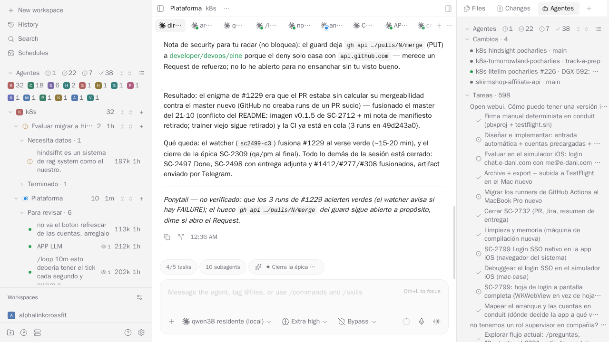

# paseo-agentes — agents by status, in one block

Paseo's sidebar lists workspaces and its status view groups **workspaces**, not agents. With one workspace per area,
you cannot see *which* agent is waiting for you. This plugin adds a block that lists every agent of the host, grouped
by exactly the states Paseo already computes: the ones asking you something, the ones running, the ones that finished
and nobody has looked at. One row opens its agent.


## The groups

The buckets and names are Paseo's own (`deriveAgentStateBucket`, in the same order as the status view):

| Group | When |
|---|---|
| Necesita datos | a permission or an `AskUserQuestion` is pending |
| Con error | the last turn ended in error |
| Para revisar | the turn ended and the agent has not been opened since (`requiresAttention`, cleared when you see it) |
| En ejecución | a turn is running |
| Terminado | seen, nothing pending — folded by default so it does not flood the sidebar |

Empty groups are not rendered; with nothing pending the block takes no space. Inside a group, newest first, by a
timestamp that does not change while the agent emits — rows do not jump under the pointer.

Each row carries its project's icon, painted the way Paseo's workspace list paints it (initial on its color, same
palette and same key). The "Agentes" header folds and unfolds the whole block — folded, it leaves a single line with
one count per group — and the project chips under the header toggle whole projects on and off, so you can look at
only your interactive sessions, or only Hermes. Folding and hidden projects persist per client.

## Left or right, configurable

A setting («Dónde se ve», in Ajustes → Plugins → `⋯` on paseo-agentes → Ajustes) chooses where the block shows, per
host, applied live without a reload:

- **Izquierda** (default): the header of the sidebar.
- **Derecha**: the block leaves the sidebar and you open it as an "Agentes" panel from the Explorer's `+` — the right
  column, next to Files and Changes.



## The same rules as the status view

So the block and Paseo's status view never disagree, the plugin mirrors the daemon's rules:

- Only root agents are rows. A child agent of the same workspace (`paseo.parent-agent-id`) does not get its own row;
  while it runs, its root shows "En ejecución".
- An agent with a live Claude subagent (a background Task or a workflow) shows "En ejecución" even when its own turn
  ended, through Paseo's `agent.provider_subagents.update` event.
- A background `Bash` (a watcher) is not a subagent for Paseo, so it does not change the group here either.

## What is running behind each agent

On the right of each row, two badges with their counts: a robot for running Claude subagents and an eye for running
watchers (background `Bash` / `Monitor` tasks of that session), children's marks summed into the row. This is the
part Paseo does not track: Claude Code keeps each task's output file open while it runs, so the plugin's server part
lists the daemon user's open files once per agent-list change (at most every 3 s) and counts those task files
per session: it scans `/proc` on Linux (~150 ms) and runs `lsof` asynchronously on macOS and other Unix without `/proc`
(5 s timeout). Where neither works (Windows, `lsof` missing or failing) the watcher counts are zero and the badges only show
subagents. A foreground command inside a live turn also holds the file, so it counts while the agent is running —
which is already visible by its group.

## Privacy

Everything stays inside your Paseo daemon. The client subscribes to the agent list and the project list through the
SDK (a snapshot plus one event per change, no polling) and listens to the subagent event. The server part only reads
which files each process of the daemon's user has open (`/proc`, or `lsof` restricted to that user). It writes nothing to the daemon except its own
settings document (the side), and calls nothing outside the daemon. Folding and hidden projects live in the
client's `localStorage`.

## Install

```sh
paseo plugin add pocharlies-org/paseo-agentes
```

or pick it in the Paseo plugin registry. Requires Paseo `>=0.11.2 <0.12.0`. The UI strings are currently Spanish
(they are Paseo's own status names); the plugin works the same in any locale.

## Development

`npm ci --ignore-scripts && npm run typecheck && npm test` — the tests cover the grouping rules, the order, the
per-row running marks (with a real process holding a fake task file open), the project icons and the persisted
folding. The subscriptions and the navigation are verified live against a running daemon.
