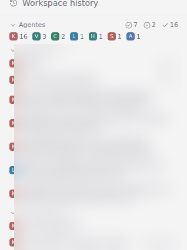

# paseo-agentes

A Paseo plugin: one block with every agent of the host, grouped by the states Paseo itself computes — the agents
asking you something, the ones running, the ones that finished and nobody has looked at — or by project and workspace,
with the workspace's own status and time on its header and the state groups inside, like Paseo's sidebar. Shown on the left
(sidebar header) or on the right (an Explorer panel), configurable per host. Each row opens its agent; each row shows
the Claude subagents and background watchers that agent has running. As the right panel it adds, like Claude Desktop:
each agent's context tokens, a «Cambios» section (the open PR of the panel's workspace branch with its GitHub Actions
state, or the branch when it has no PR) and a «Tareas» section (the task list of that workspace's agents).

**Full documentation — groups, rules, watcher detection, privacy, limits: [OVERVIEW.md](OVERVIEW.md).**



## Install

```sh
paseo plugin add pocharlies-org/paseo-agentes
```

Requires Paseo `>=0.11.2 <0.12.0`.

## Development

`npm ci --ignore-scripts && npm run typecheck && npm test`. `scripts/deploy.sh` updates the daemon's git checkout of this
repo (the installed plugin) from trunk and reloads it on the local daemon.

MIT licensed.
